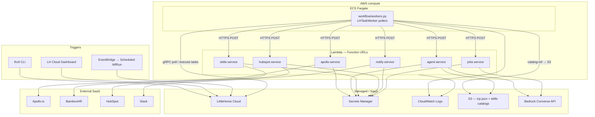
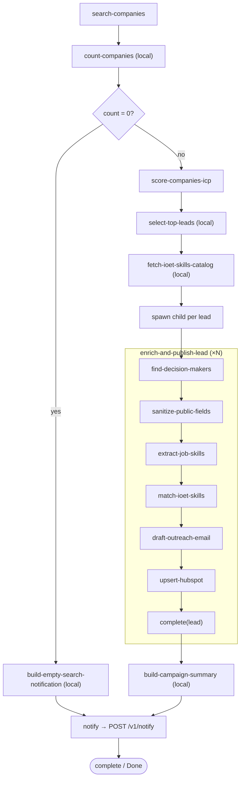
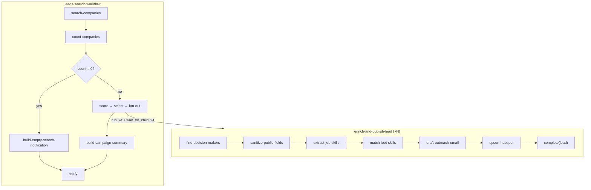
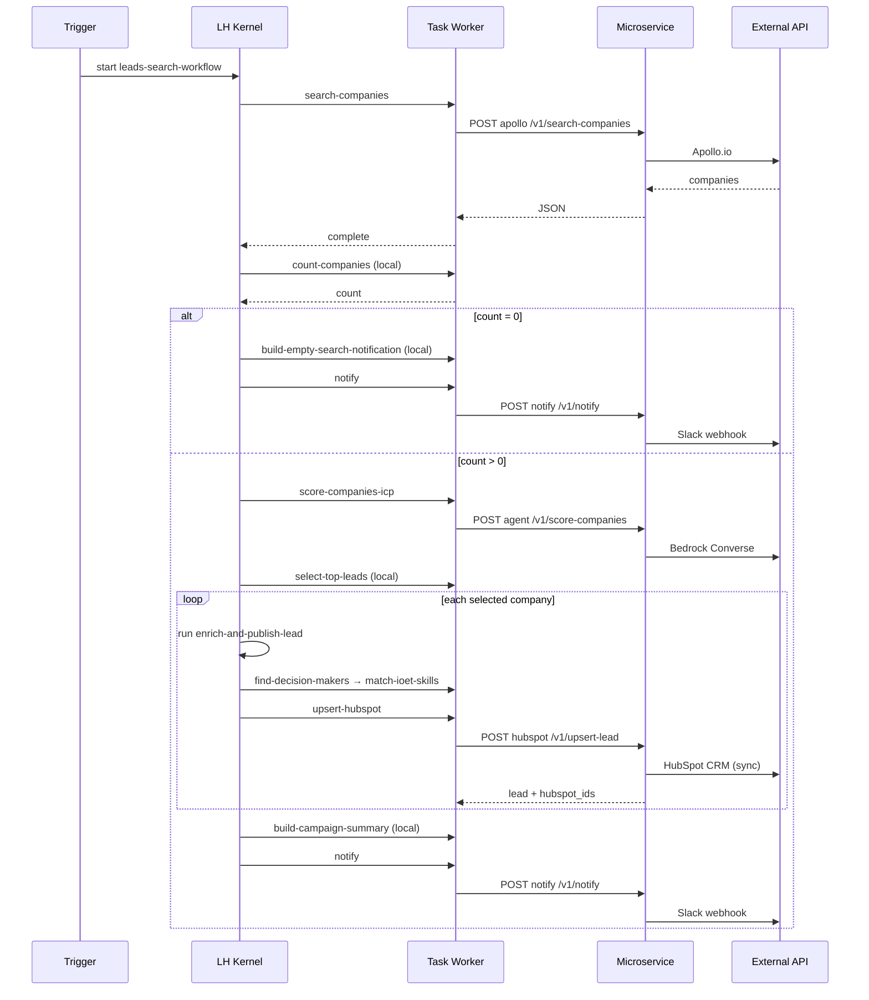
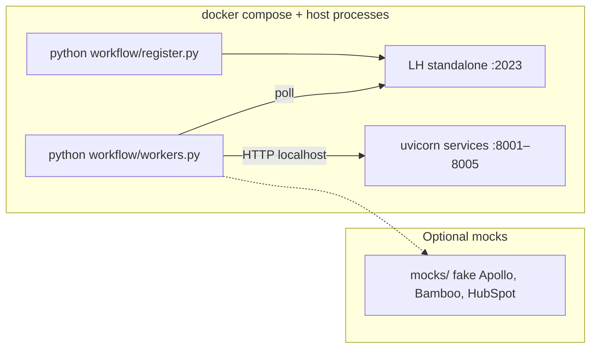
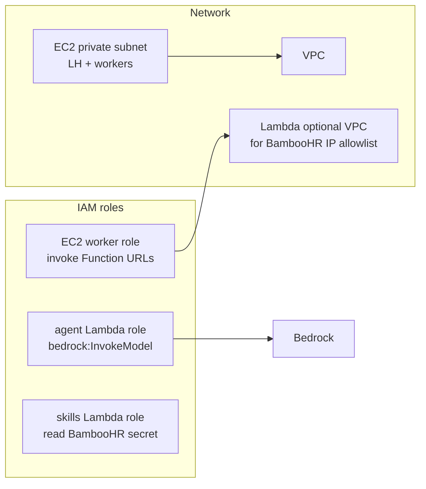
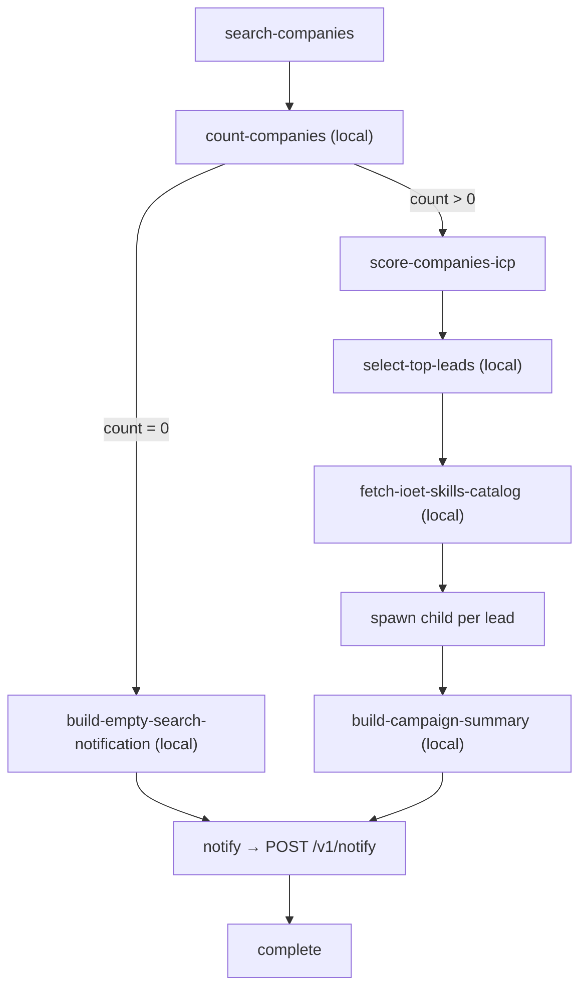
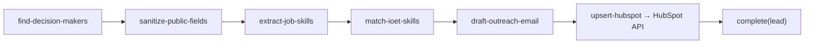

# Leads Search Agent — Architecture

**Current implementation:** two WfSpecs (parent + child), thin workers → HTTP microservices, **direct synchronous** calls to HubSpot and Slack (no SQS queue). Target AWS layout uses **LittleHorse Cloud** + ECS workers + Lambda Function URLs; local dev uses docker-compose + uvicorn.

> **How to view the graphs:** Cursor’s markdown editor shows Mermaid as source code.
> - **Browser:** open [`docs/architecture.html`](architecture.html)
> - **IDE canvas:** [leads-search-architecture.canvas.tsx](/Users/ivan/.cursor/projects/Users-ivan-ioet-repos-leads-search-agent/canvases/leads-search-architecture.canvas.tsx)
>
> Future design (not built): [outbound-queue-design.md](./outbound-queue-design.md)

---

## 1. AWS target deployment



### Runtime placement

| Component | Runtime | Why |
|-----------|---------|-----|
| **LittleHorse Kernel** | LittleHorse Cloud | Durable workflow state, WfRun orchestration, dashboard |
| **Task workers** (`workers.py`) | ECS Fargate | Long-polling gRPC to LH — not suitable for Lambda |
| **Integration services** (`services/*`) | Lambda + Function URL | Stateless HTTP; scale per invocation; no idle cost |
| **ICP config** | S3 (+ git) | Versioned object loaded at runtime |
| **Skills catalog (per campaign)** | S3 | Large Bamboo snapshot; LH only stores `catalog-ref` |
| **API keys / LH OAuth** | Secrets Manager | Apollo, HubSpot, BambooHR, Slack, Bedrock, LH Cloud |
| **LLM inference** | Bedrock (managed) | Agent/jobs call Converse via Bearer `AWS_BEDROCK_API_KEY` |
| **WfSpec registration** | CI / one-off (`register.py`) | Against LH Cloud |

Terraform for AWS lives in **infra-terraform** (`ioet-primary/ioet-leads-search`). This app repo ships container images, refreshes Lambda/ECS, uploads `icp.json`, and registers WfSpecs — see [deploy.md](./deploy.md).

---

## 2. Combined workflow (parent + child)

Single view of both WfSpecs — open [`architecture.html`](architecture.html) in a browser to render.



`(local)` = task runs in the worker process, no HTTP microservice. Each failed step uses LH retries, then `notify-failure` → Slack; the campaign continues.

---

## 3. End-to-end WfSpec hierarchy (compact)

Two WfSpecs today — no grandchild, no async outbound queue.



---

## 4. Request flow



---

## 5. Local development (current)

Same worker → HTTP pattern; services run as uvicorn instead of Lambda.



See [mocks/README.md](../mocks/README.md) for offline demos.

---

## 6. IAM & networking (planned)



---

## 7. Workflow steps (implemented)

Same graph runs locally and in AWS — only the runtime hosting changes.

**Parent:** `leads-search-workflow`



Both notify branches use the same **`notify`** task → `POST /v1/notify`. Local build tasks format `{ message, details }`; notify posts to Slack directly. Step errors use **`notify-failure`** → `POST /v1/failure`.

**Child:** `enrich-and-publish-lead` — `upsert-hubspot` calls HubSpot **synchronously** via hubspot-service (`dry_run` skips CRM writes).



---

## 8. Task → service mapping

| TaskDef | Runtime | HTTP endpoint |
|---------|---------|---------------|
| `search-companies` | apollo Lambda | `POST /v1/search-companies` |
| `score-companies-icp` | agent Lambda | `POST /v1/score-companies` |
| `find-decision-makers` | apollo Lambda | `POST /v1/find-decision-makers` |
| `sanitize-public-fields` | hubspot Lambda | `POST /v1/sanitize-public-fields` |
| `extract-job-skills` | jobs Lambda → Bedrock | `POST /v1/extract-job-skills` |
| `match-ioet-skills` | agent Lambda | `POST /v1/match-skills` |
| `draft-outreach-email` | agent Lambda | `POST /v1/draft-outreach-email` |
| `upsert-hubspot` | hubspot Lambda | `POST /v1/upsert-lead` |
| `notify` | notify Lambda | `POST /v1/notify` |
| `notify-failure` | notify Lambda | `POST /v1/failure` |
| `count-companies` | local worker | — |
| `build-empty-search-notification` | local worker | — |
| `build-campaign-summary` | local worker | — |
| `fetch-ioet-skills-catalog` | local worker → skills HTTP (once per campaign) | — |
| `select-top-leads` | local worker | — |

**External writes (sync today):** `upsert-hubspot` → HubSpot CRM; `notify` / `notify-failure` → Slack webhook.

---

## 9. Repository layout

```
leads-search-agent/
├── workflow/
│   ├── register.py          → CI / operator (registers WfSpecs to LH Cloud)
│   ├── workers.py           → ECS Fargate (long-lived pollers)
│   └── workflows/           → compiled into LH kernel via register.py
├── services/
│   ├── apollo/              → Lambda Function URL
│   ├── agent/               → Lambda Function URL (+ Bedrock)
│   ├── skills/              → Lambda Function URL
│   ├── hubspot/             → Lambda Function URL
│   ├── notify/              → Lambda Function URL
│   └── jobs/                → Lambda Function URL
├── scripts/                 → build/push, refresh runtime, register LH
├── data/icp.json            → uploaded to S3 by CI when changed
└── docker-compose.yml       → local dev only
```

AWS Terraform: `infra-terraform/ioet-primary/ioet-leads-search`.

---

## Related docs

- [Architecture plan](./leads_agent_architecture.plan.md) — design rationale and phases
- [outbound-queue-design.md](./outbound-queue-design.md) — **deferred** SQS outbound pattern
- [README](../README.md) — local setup and run commands
- [deploy.md](./deploy.md) — app-repo CI deploy (images, ICP, LH register)
