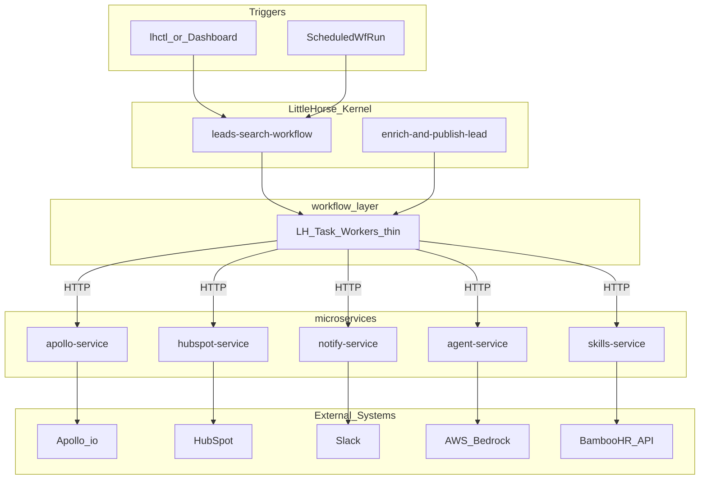
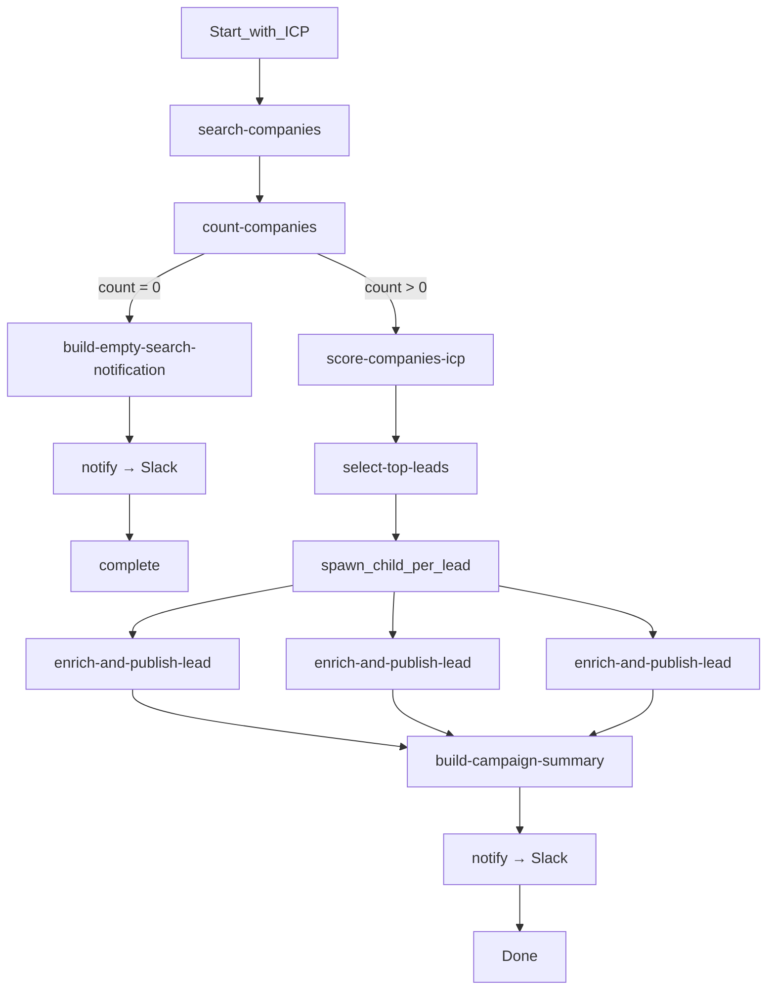

# Leads Search Agent — Architecture Plan

## Goal

Automate Diego’s current BD process (Apollo + HubSpot + LLM judgment) as a **durable LittleHorse workflow** that:

1. Finds companies matching an Ideal Customer Profile (ICP)
2. Enriches public decision-maker info via Apollo
3. Matches opportunities to ioet people’s skills
4. Publishes results to HubSpot and notifies Slack

Data policy: only **public / non-sensitive** fields (company name, domain, industry, LinkedIn URL, role/title, public notes) by default. Emails/phones stay on the denylist unless explicitly enabled later.

## Design principles

- **LittleHorse owns control flow** (retries, timeouts, fan-out, observability). AI does judgment, not orchestration.
- **Three-layer separation** (aligned with [practice3](file:///Users/ivan/studies/littlehorse/practice3)):
  - `workflow/` — WfSpec, TaskDefs, thin pollers
  - `services/` — AI + integration microservices (no LH SDK)
  - `infrastructure/` — Terraform only
- **Python** stack (matches practice3 + LLM ecosystem).
- **AWS** deployment (Lambda Function URLs + ECS for the LH worker), same pattern as practice3’s thin workers → HTTP services.

## Target architecture




**Runtime roles**


| Layer             | Responsibility                                                       | Does NOT contain                        |
| ----------------- | -------------------------------------------------------------------- | --------------------------------------- |
| `workflow/`       | WfSpec graph, TaskDef registration, polling, HTTP invoke of services | Prompts, Apollo/HubSpot SDKs, Terraform |
| `services/*`      | Business/AI/integration logic behind HTTP                            | LH SDK, infra                           |
| `infrastructure/` | AWS resources, IAM, secrets wiring, Function URLs                    | Business logic                          |


## Repository layout

```
leads-search-agent/
  workflow/
    register.py          # TaskDefs + WfSpecs
    workers.py           # thin LHTaskWorkers → HTTP
    workflows/
      leads_search.py    # parent WfSpec
      enrich_publish.py  # child WfSpec per lead
  services/
    agent/               # ICP scoring, skill matching, CRM note drafting
    apollo/              # company + people search (public fields only)
    skills/              # BambooHR employee skills lookup
    hubspot/             # company/contact/note upsert
    notify/              # Slack summary
    common/              # shared Pydantic schemas / ICP model
  infrastructure/        # Terraform (AWS)
  data/
    icp.json                 # canonical ICP (from BD PDF)
  docker-compose.yml     # local LH Kernel + services for dev
  requirements.txt
  README.md
```

Workers stay dumb (like practice3 `workflow/workers.py`): map TaskDef → `LAMBDA_URL_*` / service URL → POST JSON → return result.

## ICP source document → machine-readable config

**Source:** [ioet_Current_ICP.pdf](file:///Users/ivan/Downloads/ioet_Current_ICP.pdf) (BD Team, Aug 26 2026; grounded in 63 real clients).

**Extraction approach:** one-time **manual structured transcription** into `data/icp.json` — not an OCR/LLM parse pipeline. The PDF is short, authoritative, and changes infrequently; treating it as prose-to-schema keeps the agent deterministic and reviewable by BD. Version the JSON in git; bump `version` when BD updates the PDF.

**Split the document into two layers in JSON:**

1. **Hard filters** — map 1:1 to Apollo org/people search params (size, geo, industry tags, YC batches, titles).
2. **Soft signals / policy** — used by `score-companies-icp` (hiring/funding boost, segment priority, out-of-scope rules, messaging tier logic).

**Canonical schema (target `data/icp.json`):**

```yaml
version: "2026-08-26"
source: "ioet_Current_ICP.pdf"
prepared_by: "bdm@ioet.com"
campaign: "Remote-Hiring Nearshore"

segments:
  - id: primary
    priority: 1
    in_outbound: true
    definition: "AI/ML product & infrastructure + fintech"
    industries: [ai_ml, ai_agentic_tooling, infrastructure, data, fintech, payments, lending, insurance, banking]
    employee_count: { min: 10, max: 500 }
    funding_stages: [pre_seed, seed, series_a, series_b, series_c]
    geos: [US, CA]
    sourcing:
      yc_batches: ["Fall 2025", "Winter 2026", "Spring 2026", "Summer 2026"]
      yc_preferred: true
  - id: secondary
    priority: 2
    in_outbound: true
    definition: "Ecommerce/DTC and consumer-brand tech scaling engineering"
    industries: [ecommerce, dtc, consumer_brand_tech]
    employee_count: { min: 10, max: 500 }
    funding_stages: [pre_seed, seed, series_a, series_b, series_c]
    geos: [US, CA]
  - id: testing
    priority: 3
    in_outbound: true
    volume: low
    definition: "GovTech and security/networking"
    industries: [govtech, security, networking]
  - id: excluded_enterprise
    in_outbound: false
    definition: "Large enterprises and IT services/SIs"
    examples: [EY, HPE, "Tech Mahindra"]
    reason: "Partnership motion, not cold outbound"

buyer_personas:
  - tier: 1
    titles: [Founder, Co-Founder, CEO, CTO, "Chief Product & Tech Officer"]
    company_size_hint: { max_employees: 150 }
    messaging: exec_roi
  - tier: 2
    titles: ["VP Engineering", "Head of Engineering"]
    company_size_hint: { min_employees: 150 }
    messaging: exec_roi
    reach_with: [1]
  - tier: 3
    titles: ["Engineering Manager"]
    company_size_hint: { min_employees: 150 }
    messaging: team_capacity
    secondary_contact: true

prioritization_signals:   # soft boosts, not hard filters
  - recent_raise
  - live_job_posting
  - stated_hiring_need

systems:
  company_search: apollo
  contact_enrichment: apollo
  crm: hubspot
  # linkedin_sales_nav / smartlead: out of initial scope (manual/email channels)

data_policy:
  hubspot_allowlist: [name, domain, industry, linkedin_url, title, skill_match_note]
  hubspot_denylist: [email, phone]
```

**How services consume it**


| Consumer                                | Uses from ICP                                                                                        |
| --------------------------------------- | ---------------------------------------------------------------------------------------------------- |
| `apollo-service` `search-companies`     | primary/secondary `industries`, `employee_count`, `funding_stages`, `geos`, optional YC batch filter |
| `apollo-service` `find-decision-makers` | `buyer_personas[].titles` selected by company size vs tier hints                                     |
| `agent-service` `score-companies-icp`   | segment priority, soft signals, `excluded_enterprise` rules + rationale                              |
| Parent WfSpec                           | load ICP by `icp_version` (or inline override); default file/S3 object `data/icp.json`               |


**Workflow input change:** prefer `icp_version` + `segment_ids` (e.g. `["primary"]`) over pasting the full ICP blob on every run. Full ICP remains the config artifact; WfRun only selects which segments to hunt.

## High-level workflow

**Parent WfSpec: `leads-search-workflow`**

Inputs: `icp_version` (str), `segment_ids` (list), `campaign_id`, `max_leads`, `dry_run` (bool).




**Child WfSpec: `enrich-and-publish-lead`** (one company)

1. `find-decision-makers` — Apollo people search (titles from ICP)
2. `sanitize-public-fields` — strip/block sensitive fields per data_policy
3. `match-ioet-skills` — agent + skills service
4. `upsert-hubspot` — company + contacts + note with skill match (skipped if `dry_run`); **sync** HubSpot API via hubspot-service
5. `complete(lead)` — return enriched lead with `hubspot_ids`

**Error handling (LH-native)**

- Per-task timeout + retries with backoff for Apollo/HubSpot rate limits
- `handle_error` → `notify-failure` then continue/skip lead (don’t fail whole campaign)
- Idempotency keys: HubSpot upsert by domain / LinkedIn URL

## TaskDefs / tools (by service)

### `apollo-service`

- `search-companies` — ICP filters (industry, size, geo, keywords)
- `find-decision-makers` — people at company by title patterns
- Returns only allowlisted public fields

### `agent-service` (AWS Bedrock)

- `score-companies-icp` — rank/filter with short rationale
- `match-ioet-skills` — map company signals → BambooHR skill tags + confidence
- `draft-crm-note` — short HubSpot note (public, non-sensitive)
- Stateless HTTP; prompts live only here
- Calls **Bedrock Converse API** over HTTPS with `AWS_BEDROCK_API_KEY` (Bearer token)
- Model ID via env (e.g. `google.gemma-3-4b-it`, `amazon.nova-lite-v1:0`)

### `skills-service` (BambooHR)

- `get-skills-catalog` / `lookup-skills` — live pull from **BambooHR API** (employee directory + custom skill fields)
- Normalize BambooHR payloads into: `{employee_id, display_name, job_title, skills[], department}` (field allowlist — no salary, SSN, personal contact PII)
- Short TTL in-memory/cache per WfRun batch to avoid hammering BambooHR during child fan-out
- Auth: BambooHR API key in Secrets Manager; subdomain via config

### `hubspot-service`

- `POST /v1/sanitize-public-fields` — in-memory allowlist
- `POST /v1/upsert-lead` — sync CRM writes (company, contacts, note); `dry_run` returns synthetic IDs

### `notify-service`

- `notify` — message-agnostic Slack post via `POST /v1/notify` (`{ message, details }`)
- `notify-failure` — step error alerts via `POST /v1/failure`
- Local build tasks (`build-campaign-summary`, `build-empty-search-notification`) format messages; notify service posts as-is

No ReAct mega-agent as a single TaskRun. That would hide the orchestration value LittleHorse is meant to show.

## Data contracts

**ICP:** canonical file `data/icp.json` (schema above), validated by Pydantic in `services/common/icp.py`. PDF is provenance only.

**Lead result** (internal): company `{name, domain, industry, linkedin_url, segment_id, icp_score, rationale, signals[]}`, contacts `{full_name, title, linkedin_url, persona_tier}`, `skill_matches[{skill, person_or_team, confidence}]`, `hubspot_ids`, `status`.

**Allowlist for HubSpot writes:** name, domain, industry, LinkedIn URLs, titles, skill-match note. Explicitly exclude email/phone by default via `data_policy` (can be relaxed later if BD requests enrichment fields).

**Out of initial scope (not automated yet):** LinkedIn Sales Navigator outreach, Smartlead email sequences.

## Deployment strategy

### Local development

- `docker-compose`: LittleHorse Kernel (+ Kafka if required by chosen LH image), all five services
- `.env` for LH + API keys (Apollo, HubSpot, BambooHR, Slack); Bedrock via local AWS creds/profile
- Optional BambooHR stub/fixture only for offline unit tests — runtime path is the real API
- `workflow/register.py` then `workflow/workers.py` against local URLs

### Cloud — Terraform in `infrastructure/`

- **Services**: AWS Lambda + Function URLs (same as practice3) for apollo/skills/hubspot/notify/agent
- **LH workers**: ECS Fargate service (long-lived pollers); env injected with Function URLs
- **IAM**: agent Lambda/task role with `bedrock:InvokeModel` / Converse permissions for the chosen model
- **Secrets**: AWS Secrets Manager (Apollo, HubSpot, BambooHR API key, Slack, LH credentials) — no LLM API keys
- **Observability**: CloudWatch logs; LH Dashboard for WfRun inspection (primary demo surface)
- **Triggers**: manual via Dashboard/`lhctl` for demos; optional `ScheduledWfRun` for recurring campaigns

### Environments

- `dev` / `demo` Terraform workspaces or var files
- `dry_run=true` default in demo until HubSpot sandbox confirmed

## Implementation phases (when building starts)

1. **ICP** — write `data/icp.json` + Pydantic model from the BD PDF; unit-test hard-filter mapping
2. **Scaffold** monorepo layout, shared schemas, docker-compose LH + stub services
3. **Integrations** apollo + hubspot + notify + BambooHR skills (no AI yet); happy-path WfSpec with stubs
4. **AI tasks** score + skill match + note drafting behind `agent-service` via Bedrock (ICP soft signals)
5. **Hardening** retries, allowlist sanitizer, dry-run, Slack summary, BambooHR rate-limit cache
6. **Infra** Terraform pack/deploy Lambdas + ECS worker + Bedrock IAM; demo runbook

## Defaults locked

- Language: **Python 3.13**
- Orchestrator: **LittleHorse** (WfSpec-as-code)
- LLM: **AWS Bedrock** (Converse API; model ID configurable)
- Lead source: **Apollo.io** (HubSpot as sink, not primary search)
- ICP source: `**data/icp.json**` transcribed from BD PDF (primary = AI/ML + fintech, 10–500, US/CA, YC-preferred)
- Skills source: **BambooHR API** (live; field allowlist only)
- Publish: **HubSpot** + **Slack** summary
- Cloud: **AWS** via Terraform, practice3-style thin workers
- AI scope: **discrete judgment tasks**, LH orchestrates the pipeline
- Default hunt segment for first demos: `**primary` only**

