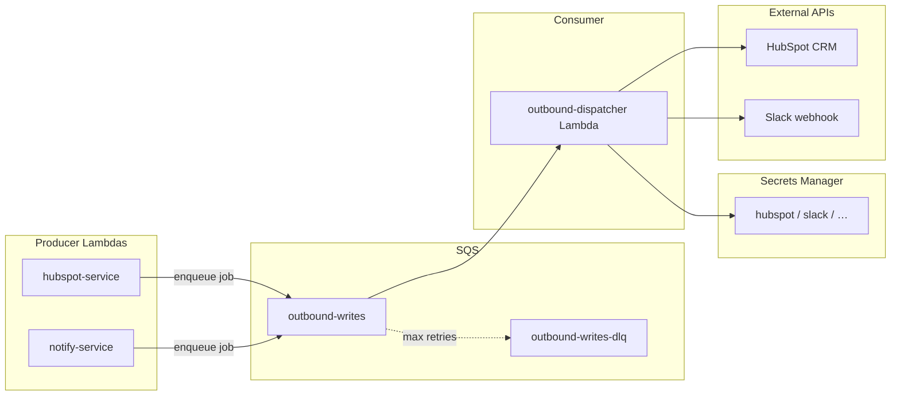

# Outbound write queue — design requirements

> **Status: DEFERRED — not implemented.** Current code calls HubSpot and Slack **directly and synchronously** from `hubspot-service` and `notify-service`. See [architecture.md](./architecture.md) for the live system.

Queue all **external write** operations (HubSpot CRM, Slack, future targets) through SQS. Producer Lambdas enqueue; a single **outbound-dispatcher** Lambda consumer executes the actual HTTP calls.

---

## 1. Scope

| In scope | Out of scope (stay synchronous) |
|----------|----------------------------------|
| `POST /v1/upsert-lead` (HubSpot writes) | `POST /v1/sanitize-public-fields` (in-memory) |
| `POST /v1/notify` (Slack) | Apollo / Bedrock / BambooHR **reads** |
| `POST /v1/failure` (Slack) | `dry_run` handling in producer (no enqueue) |

**Producers:** `hubspot-service`, `notify-service`  
**Consumer:** `outbound-dispatcher` Lambda (SQS trigger)  
**Queue:** `outbound-writes` (+ DLQ)

---

## 2. Target architecture



---

## 3. Message envelope (recommended)

Use a **two-layer** payload: transport metadata + either a raw HTTP request **or** a named operation.

```json
{
  "schema_version": "1",
  "message_id": "550e8400-e29b-41d4-a716-446655440000",
  "idempotency_key": "hubspot:upsert-lead:domain:acme.com:campaign:demo-001",
  "correlation": {
    "wf_run_id": "…",
    "task_run_id": "…",
    "campaign_id": "demo-001",
    "step": "upsert-hubspot"
  },
  "target": "hubspot",
  "mode": "operation",
  "operation": "upsert_lead",
  "payload": {
    "lead": { "company": { "name": "Acme", "domain": "acme.com" }, "contacts": [] },
    "dry_run": false
  }
}
```

**Slack (single HTTP call — fits raw mode):**

```json
{
  "schema_version": "1",
  "message_id": "…",
  "idempotency_key": "slack:notify:campaign:demo-001:wf:…",
  "correlation": { "wf_run_id": "…", "step": "notify" },
  "target": "slack",
  "mode": "http",
  "request": {
    "method": "POST",
    "url_secret": "slack/webhook_url",
    "headers": { "Content-Type": "application/json" },
    "body": { "text": "Leads campaign `demo-001`: 3 published." }
  }
}
```

### Fields

| Field | Required | Purpose |
|-------|----------|---------|
| `schema_version` | yes | Evolve envelope without breaking consumer |
| `message_id` | yes | Logging, dedup audit |
| `idempotency_key` | yes | At-least-once SQS → safe retries |
| `correlation` | recommended | Trace back to WfRun / campaign |
| `target` | yes | Route to adapter / secret namespace |
| `mode` | yes | `http` \| `operation` |
| `operation` | if `mode=operation` | Adapter method name |
| `payload` | if `mode=operation` | Adapter input |
| `request` | if `mode=http` | Raw HTTP spec |

**Secret resolution:** Consumer resolves `url_secret`, `auth_secret` from Secrets Manager by `target` — never embed tokens in SQS messages.

---

## 4. Consumer design

### 4.1 Dispatcher (agnostic shell)

```
on SQS record:
  parse envelope → validate schema_version
  check idempotency store (DynamoDB) → skip if already succeeded
  adapter = ADAPTERS[target]
  if mode == "http":   adapter.execute_http(request)
  if mode == "operation": adapter.execute(operation, payload)
  mark idempotency success | rethrow for SQS retry
```

### 4.2 Adapters (target-specific)

| Target | Mode | Notes |
|--------|------|-------|
| `slack` | `http` | One POST to webhook — fully generic |
| `hubspot` | `operation` | `upsert_lead` runs multi-step CRM logic (search → upsert → associate → note) |
| future | either | Simple APIs → `http`; orchestration → `operation` |

**Important:** A consumer that only understands `{ target, method, url, body }` works for Slack but **not** for HubSpot as implemented today. `upsert_lead` issues 5–10 conditional HTTP calls with ordering dependencies. Options:

1. **Recommended:** `operation` mode — move existing `HubSpotClient` orchestration into `HubSpotAdapter` inside the consumer (or shared lib).
2. **Alternative:** Producer expands one upsert into N ordered SQS messages (`sequence_id`, `step_index`) — consumer stays HTTP-only but queue design gets complex.
3. **Avoid:** Producer queues one opaque blob and consumer re-imports hubspot-service — couples consumer to producer deployment.

---

## 5. Producer behaviour

### hubspot-service `/v1/upsert-lead`

1. Validate + sanitize lead (unchanged).
2. If `dry_run`: return synthetic `hubspot_ids` immediately — **do not enqueue**.
3. Else: `sqs.send_message(envelope)` → return **202-style** response (see §6).

### notify-service `/v1/notify` and `/v1/failure`

1. Build envelope (`mode: http` for Slack).
2. Enqueue → return acceptance response.

Shared helper: `services/common/outbound_queue.py` — `enqueue(envelope) -> message_id`.

---

## 6. Critical gap: LittleHorse expects synchronous task results

Today `upsert-hubspot` **returns** `LeadResult` with real `hubspot_ids`. The workflow child completes with that object.

If enqueue is fire-and-forget, the task returns before HubSpot writes finish → **workflow loses CRM IDs and success/failure signal**.

Pick one strategy:

| Strategy | Pros | Cons |
|----------|------|------|
| **A. Async workflow change** | Clean queue semantics | LH WfSpec must not depend on `hubspot_ids`; status = `queued` |
| **B. Result callback** | Keeps async writes | Need DynamoDB/S3 result store + new LH “wait for outbound” task or external event |
| **C. Sync wait in producer** | Minimal WfSpec change | Producer polls result table — fragile, timeouts, defeats queue decoupling |
| **D. HubSpot stays sync; only Slack queued** | Simplest migration | Partial architecture |

**Recommendation for v1:** Queue **Slack only** (notify + failure). Keep HubSpot sync until you add **B** (result store + correlation_id, consumer writes outcome, optional follow-up task polls or webhook wakes LH).

If HubSpot must queue in v1: return `{ status: "queued", message_id, lead }` and accept that child WfSpec `complete(lead)` no longer has real HubSpot IDs until a later reconciliation job runs.

---

## 7. Infrastructure checklist

| Piece | Purpose |
|-------|---------|
| SQS `outbound-writes` | Main queue (consider **FIFO** if ordering per `idempotency_key` / message group) |
| SQS `outbound-writes-dlq` | Poison messages after `maxReceiveCount` |
| Lambda `outbound-dispatcher` | SQS event source mapping, batch size 1–10 |
| DynamoDB `outbound-idempotency` | TTL ~7d, key = `idempotency_key` — dedup successes |
| DynamoDB `outbound-results` (optional) | If strategy B — `{ message_id → status, response, hubspot_ids }` |
| Secrets Manager | `hubspot/access_token`, `slack/webhook_url`, … |
| IAM | Producers: `sqs:SendMessage`. Consumer: `sqs:*`, `secretsmanager:GetSecretValue`, no producer secrets |
| CloudWatch | Metrics: enqueue count, dispatch latency, failures by `target`, DLQ depth |
| Alarm | DLQ > 0, consumer errors, age of oldest message |

### SQS settings

- **Visibility timeout** ≥ Lambda timeout + buffer (e.g. 6 min if Lambda 5 min).
- **Retention** 4–14 days.
- **FIFO message group** = `idempotency_key` prefix or `campaign_id` if strict per-lead ordering needed.

---

## 8. Reliability & security

- **At-least-once delivery** → idempotency store mandatory for HubSpot upserts.
- **Rate limits** — consumer reserved concurrency per target; exponential backoff on 429 (HubSpot).
- **PII in queue** — messages contain lead/contact data; encrypt queue (SSE-SQS or KMS), restrict IAM, short retention if possible.
- **No secrets in body** — use `url_secret` / `auth_secret` keys only.
- **Partial HubSpot failure** — adapter should log which step failed; DLQ message includes `correlation` for manual replay.
- **Schema versioning** — consumer rejects unknown `schema_version` → DLQ with clear error.

---

## 9. What you might be missing

1. **HubSpot multi-step vs generic HTTP** — biggest design fork (§4.2).
2. **Synchronous WfRun vs async writes** — biggest product/workflow impact (§6).
3. **Idempotency store** — not optional with SQS retries.
4. **DLQ + replay runbook** — who replays, how to inspect failed envelopes.
5. **dry_run** — must short-circuit in producer, never enqueue.
6. **notify-failure** — include in same queue (same Slack adapter).
7. **Observability** — propagate `correlation.wf_run_id` into all logs and Slack messages.
8. **Local dev** — LocalStack SQS or “direct dispatch” fallback when `OUTBOUND_QUEUE_URL` unset (like mocks today).
9. **Testing** — contract tests for envelope schema; consumer adapter tests with HTTP mocked.
10. **FIFO vs Standard** — if HubSpot operations must not reorder per lead, use FIFO with `MessageGroupId`.

---

## 10. Suggested rollout

| Phase | Deliverable |
|-------|-------------|
| **1** | Envelope schema + `outbound_queue.py` + Terraform SQS/DLQ |
| **2** | `outbound-dispatcher` with Slack `http` adapter; notify-service enqueues only |
| **3** | Idempotency DynamoDB + DLQ alarms |
| **4** | HubSpot `operation` adapter OR result-callback pattern for LH |
| **5** | Architecture docs + local dev fallback |

---

## 11. Open decisions

1. HubSpot v1: queue + lose sync IDs, or keep sync until result callback exists?
2. FIFO queue for HubSpot ordering, or Standard + operation adapter handles sequencing internally?
3. Single consumer Lambda vs one per target (start with single + adapters).
4. Should `failure` notifications bypass queue for lower latency on errors?

---

## Related

- [architecture.md](./architecture.md) — deployment topology
- [leads_agent_architecture.plan.md](./leads_agent_architecture.plan.md) — workflow pipeline
